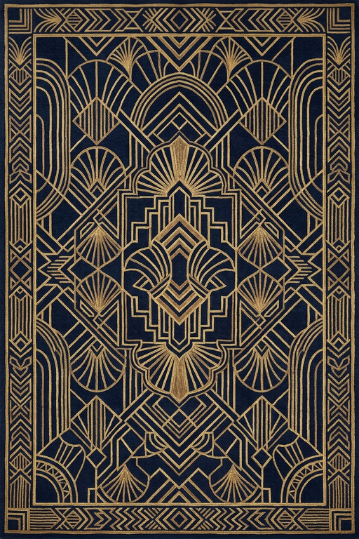
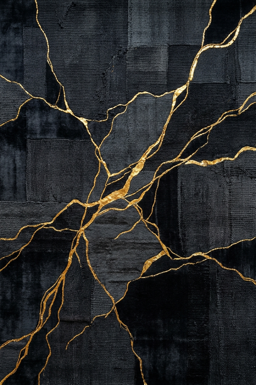
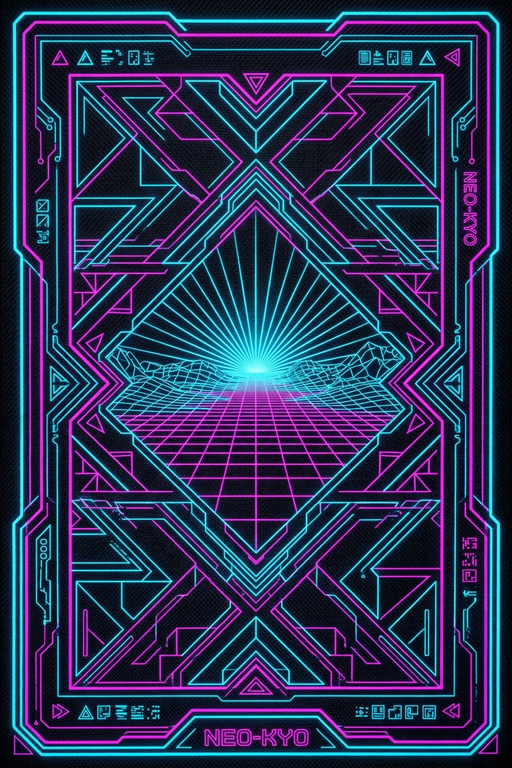

# CarpetZen: ASMR Rug Deep Clean 🫧

> **CarpetZen** is a tactile, oddly-satisfying casual ASMR simulation game designed from the ground up for mobile browsers and WebGL platforms. Players scrub, wash, and restore dirty carpets using responsive tools while enjoying a calming Lo-Fi audio landscape and evolving room aesthetics.

---

## 🎮 Key Features

### 1. Tactile GPU-Accelerated Scrubbing
* **GPU SDF Mask Interpolation**: Sweeps are rendered continuously between touch points with zero gaps, regardless of touch speed or device framerate.
* **0% CPU Pixel Overhead**: All dirt mask evaluation, blending, and foam edges run on lightweight custom shaders (`CarpetComposite.shader` & `BrushStamp.shader`).
* **Tactile Tools**:
  * **Round Brush (Круглая щётка)** — Balanced, cozy standard cleaning tool.
  * **T-Scraper (Т-образный скребок)** — Wide brass blade providing +50% sweep width and accelerated clear speed.

### 2. 33 Distinct Carpet Masterpieces
Players unlock and restore a massive collection of 33 carpets:
* **8 Procedural Base Carpets**: Clean geometric, Scandi, Berber, and garden patterns.
* **25 High-Definition Designer Skins**: Rich cultural and artistic styles including Persian Medallion, Japanese Koi Pond, Golden Art Deco, Black Kintsugi, Anatolian Kilim, and Cyberpunk Neon.

### 3. Dynamic 10-Tier Visual Progression
Every 10 levels, the game transitions into a distinct visual palette affecting room flooring, ambient lighting, camera slates, and modal styling:
1. **Levels 1–10**: 🩵 **Лазурный Уют** (Sky Azure & Nordic Oak) — *Tranquil starting atmosphere*
2. **Levels 11–20**: 🌿 **Мятный Релакс** (Fresh Crisp Mint & White Birch)
3. **Levels 21–30**: 🌅 **Теплый Закат** (Terracotta Sandstone & Sunset Peach)
4. **Levels 31–40**: 🌙 **Лавандовые Мечты** (Smoked Lilac & Midnight Indigo)
5. **Levels 41–50**: 🌸 **Розовый Кварц** (Pastel Sakura Rose & Rosewood)
6. **Levels 51–60**: 🍯 **Медовый Уют** (Warm Butter Amber & Golden Oak)
7. **Levels 61–70**: 🌊 **Глубокий Океан** (Deep Navy Sapphire & Coastal Driftwood)
8. **Levels 71–80**: 🍵 **Матча Дзен** (Forest Moss & Japanese Bamboo)
9. **Levels 81–90**: 🍃 **Эвкалипт и Мрамор** (Seafoam Turquoise & Carrara Marble)
10. **Levels 91–99**: 🌌 **Звездный Космос** (Cosmic Neon Violet & Obsidian)
* **Level 100 Centennial Milestone**: 👑 **Гранд-Мастер 100** (Imperial Royal Gold & Obsidian Aura)

### 4. Interactive ASMR Audio System
* **Velocity-Modulated Scrubbing Loop**: Organic ASMR audio pitch and volume react dynamically to real-time drag velocity.
* **11 Harmonious Lo-Fi Soundtracks**: Smooth crossfading between tiers, with a special milestone soundtrack reserved exclusively for Level 100.
* **Procedural Sound FX**: Bubbly pops, crystal coin chimes, star fanfare, and calming harp chords.

### 5. Progression & In-Game Shop
* **Bubble Economy (🫧)**: Earn currency for level completion and 3-star cleaning milestones.
* **Economy Balance**: Designer rugs range from **1,500 🫧** to **75,000 🫧** for rewarding long-term player motivation.
* **Full Progress Reset**: Dedicated safety-confirmed progress reset supporting clean restarts.

---

## 🖼️ Carpet Gallery Preview

| Персидский Исфахан (Persian) | Золотой Арт-Деко (Art Deco) | Карпы Кои (Japanese Koi) |
| :---: | :---: | :---: |
|  |  |  |

| Черный Кинцуги (Kintsugi) | Киберпанк Неон (Cyberpunk) | Азулежу Прованс (Azulejo) |
| :---: | :---: | :---: |
|  |  |  |

---

## 🛠️ Technical Architecture

* **Engine**: Unity 6 / Unity 2022.3 LTS
* **Render Pipeline**: Built-in / Universal Render Pipeline (Mobile Optimized)
* **Aspect Ratio**: Portrait 9:16 (Adaptive Canvas Scaler)
* **Performance Benchmark**:
  * Steady 60 FPS on mid-range Android and iOS mobile web browsers.
  * Sub-millisecond cleanliness evaluation via periodic 32x32 CPU downsampling.
  * Zero GC allocs during active scrubbing loops.

---

## 📄 Intellectual Property & Licensing

This repository serves as a **portfolio showcase**.  
The underlying gameplay source code, custom shaders, and commercial assets are proprietary.

**Copyright (c) 2026. All rights reserved.**  
Unauthorized reproduction, distribution, decompilation, or commercial utilization of these assets is prohibited without explicit written permission.
