# CarpetZen: ASMR Глубокая Чистка Ковров 🫧

> **CarpetZen** — расслабляющая и медитативная казуальная ASMR-игра про глубокую чистку и реставрацию ковров, созданная с нуля для мобильных браузеров и WebGL-платформ (Яндекс Игры). Игроки очищают загрязнённые ковры отзывчивыми инструментами под уютный Lo-Fi саундтрек и плавно сменяющиеся визуальные атмосферы комнат.

---

## 🎮 Ключевые особенности игры

### 1. Тактильная чистка на GPU-шейдерах
* **SDF-интерполяция маски кисти**: линия стирания грязи просчитывается плавно и непрерывно между точками касания — без разрывов и "лесенок", даже при очень быстрых свайпах.
* **0% нагрузки на центральный процессор**: смешивание слоёв чистого ковра, пены и маски грязи выполняется на видеокарте через оптимизированный шейдер `CarpetComposite.shader`.
* **Инструменты с разной механикой**:
  * 🧽 **Круглая щётка** — сбалансированный и мягкий базовый инструмент.
  * 🪓 **Т-образный латунный скребок** — широкое лезвие с увеличенным на **+50%** радиусом очистки для быстрого прохождения.

### 2. Коллекция из 32 уникальных ковров
* **8 базовых процедурных стилей**: скандинавские, берберские, геометрические и природные паттерны.
* **24 авторских дизайнерских ковра**: шедевры с высокой детализацией — *Персидский Исфахан, Золотой Арт-Деко, Пруд с Карпами Кои, Чёрный Кинцуги, Неоновый Киберпанк, Тибетский Тигр* и другие.

### 3. Динамическая система 10 визуальных тем (Тиров)
Каждые 10 уровней интерьер комнаты полностью преображается — меняются паркет, цвет стен, окружающий свет и оформление интерфейса:
1. **Уровни 1–10**: 🩵 **«Лазурный Уют»** (Небесно-голубой стиль и нордический дуб) — *спокойный стартовый интерьер*
2. **Уровни 11–20**: 🌿 **«Мятный Релакс»** (Свежая мята и белая берёза)
3. **Уровни 21–30**: 🌅 **«Теплый Закат»** (Терракотовый песчаник и персиковый коралл)
4. **Уровни 31–40**: 🌙 **«Лавандовые Мечты»** (Пепельная сирень и индиго)
5. **Уровни 41–50**: 🌸 **«Розовый Кварц»** (Нежная сакура и розовое дерево)
6. **Уровни 51–60**: 🍯 **«Медовый Уют»** (Тёплый янтарный мёд и золотой дуб)
7. **Уровни 61–70**: 🌊 **«Глубокий Океан»** (Морской сапфир и выбеленный плавник)
8. **Уровни 71–80**: 🍵 **«Матча Дзен»** (Лесной мох и тёмный кедр)
9. **Уровни 81–90**: 🍃 **«Эвкалипт и Мрамор»** (Бирюзовая морская пена и белый мрамор)
10. **Уровни 91–99**: 🌌 **«Звездный Космос»** (Неоновый фиолетовый и обсидиан)
* **Юбилейный 100-й уровень**: 👑 **«Гранд-Мастер 100»** (Императорское золото, тёмная аура и эксклюзивный саундтрек)
* **Для уровней 101+**: включена плавная циклическая смена тиров — интерьеры продолжают разнообразно обновляться каждые 10 уровней.

### 4. Интерактивная ASMR-аудиосистема
* **Тактильный звук трения**: громкость и высота бархатного звука чистки динамически модулируются скоростью движения пальца игрока.
* **11 атмосферных Lo-Fi саундтреков**: плавный кроссфейд между темами, а для 100-го уровня зарезервирован специальный праздничный трек `Music_ZenCozy` (калимба и акустический эмбиент).
* **Сочные эффекты**: мягкие щелчки лопающихся пузырей, звон золотых монет и звёздная церемония победы.

### 5. Экономика и магазин
* **Пузырьковая валюта (🫧)**: выдаётся за прохождение уровней и безупречную очистку на 3 звезды.
* **Сбалансированная прогрессия**: цены на покупку скинов варьируются от **1 500 🫧** до **75 000 🫧**, мотивируя возвращаться в игру.
* **Полный сброс прогресса**: безопасная кнопка подтверждения сброса, позволяющая начать путь заново с 1-го уровня.

---

## 🖼️ Галерея авторских дизайнерских ковров (24 стиля)

| **Сканди Бохо** *Солнце и теплые арки* | **Японский Дзен** *Сад камней и песок* | **Ретро 70-х** *Слоистые солнечные арки* |
| :---: | :---: | :---: |
| 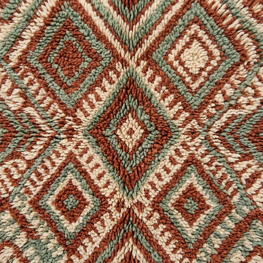 | 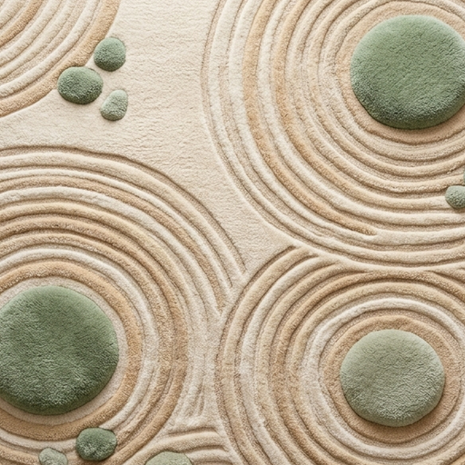 | 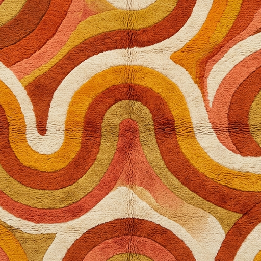 |

| **Сакура на Воде** *Розовые лепестки и рябь* | **Золотая Мандала** *Сакральный лотос и индиго* | **Баухаус Модерн** *Геометрические блоки* |
| :---: | :---: | :---: |
| 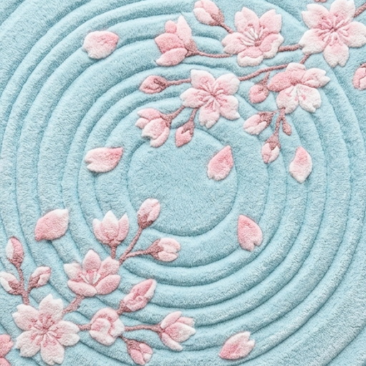 | 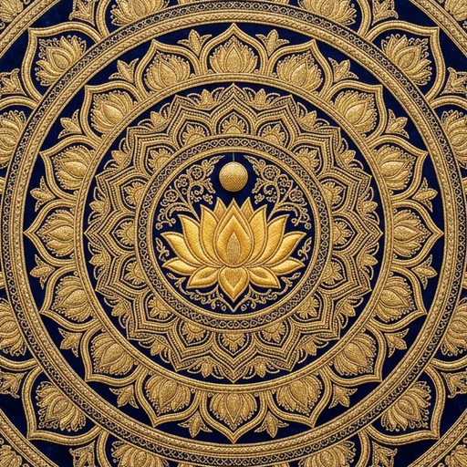 | 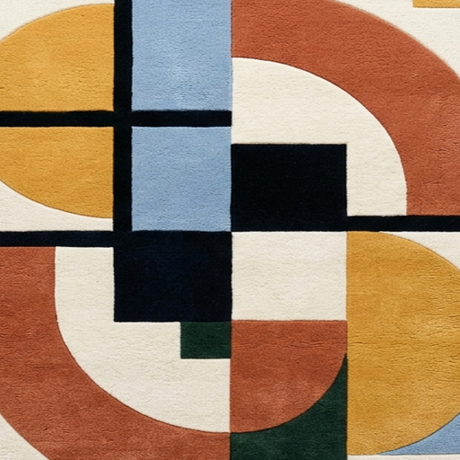 |

| **Тропическая Монстера** *Изумрудные листья* | **Звездная Галактика** *Полумесяц и созвездия* | **Морская Лагуна** *Бирюзовые волны прибоя* |
| :---: | :---: | :---: |
| 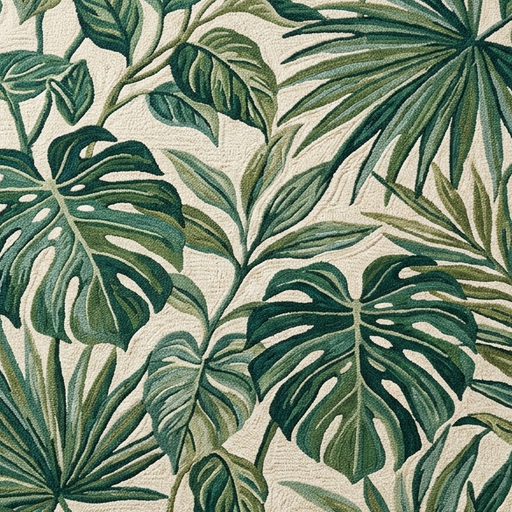 | 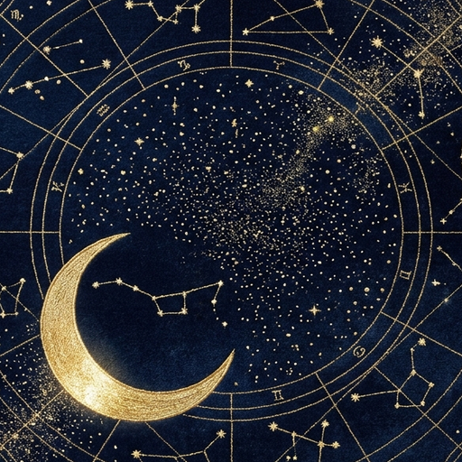 | 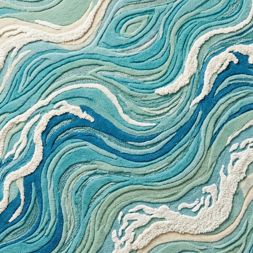 |

| **Берберский Трельяж** *Овечья шерсть и ромбы* | **Персидский Исфахан** *Королевский медальон* | **Изумрудный Павлин** *Малахит и бархат* |
| :---: | :---: | :---: |
| 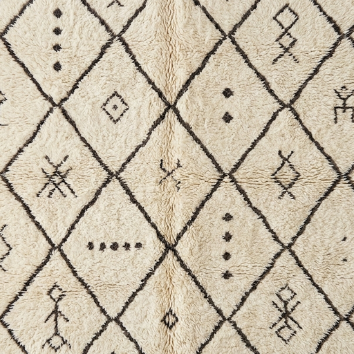 | 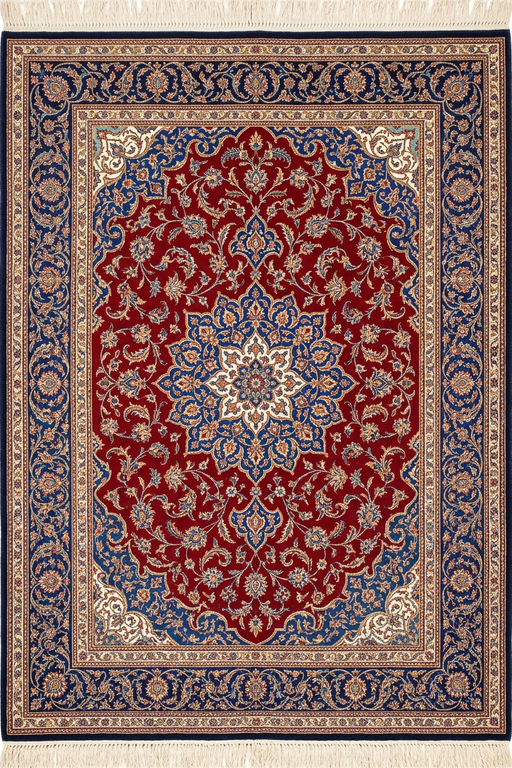 | 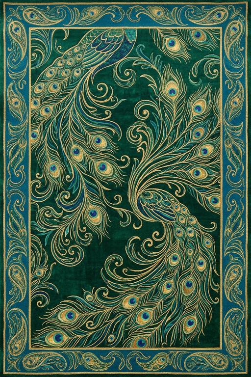 |

| **Золотой Арт-Деко** *Эпоха Гэтсби* | **Пруд с Карпами Кои** *Японский шелк* | **Небесная Астролябия** *Созвездия и луна* |
| :---: | :---: | :---: |
|  | 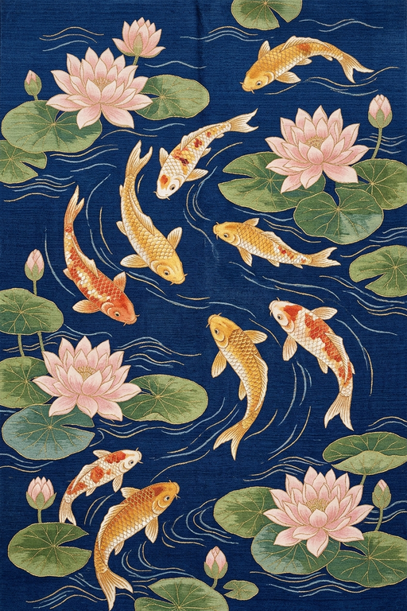 | 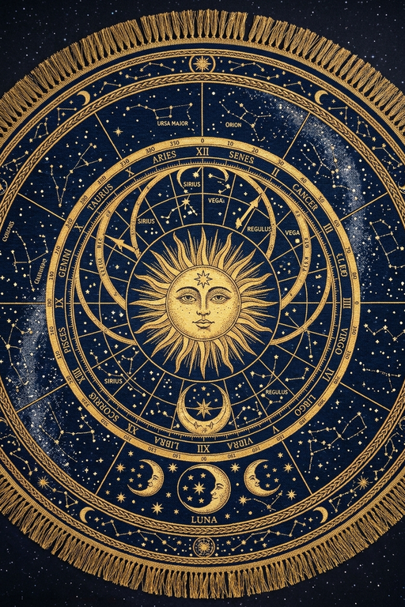 |

| **Марокканский Бени Урен** *Берберский уют* | **Киберпанк Неон** *Синтвейв ретро* | **Версальское Барокко** *Королевский гобелен* |
| :---: | :---: | :---: |
| 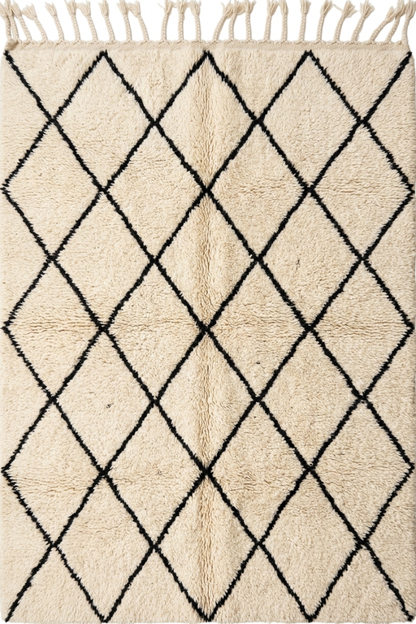 |  | 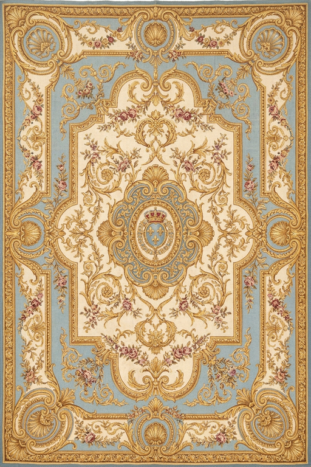 |

| **Черный Кинцуги** *Золотые трещины* | **Тибетский Тигр** *Священная охра* | **Азулежу Прованс** *Португальская мозаика* |
| :---: | :---: | :---: |
|  | 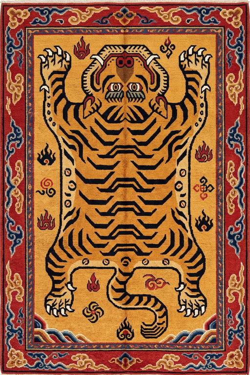 | 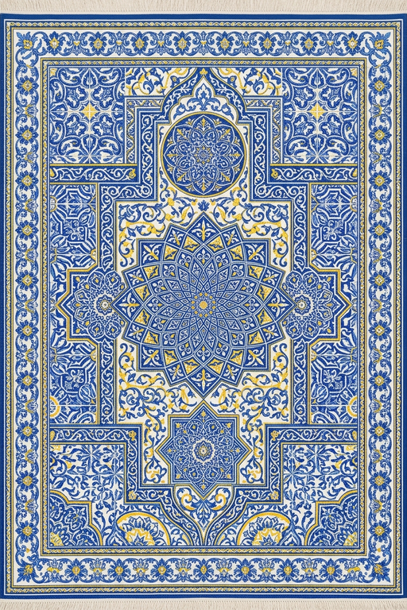 |

| **Тропическая Монстера** *Джунгли и пальмы* | **Медовая Лаванда** *Уютные соты* | **Сканди Баухаус** *Пастельные арки* |
| :---: | :---: | :---: |
| 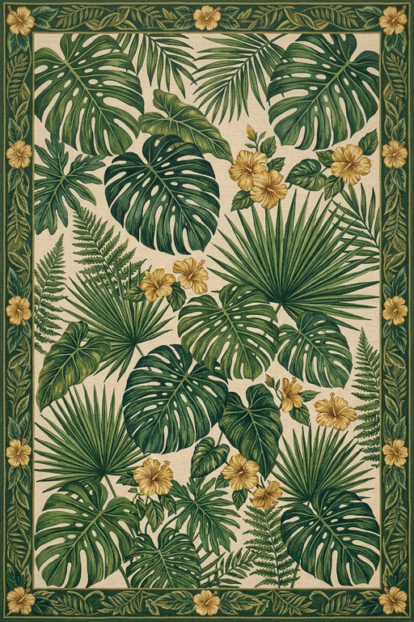 | 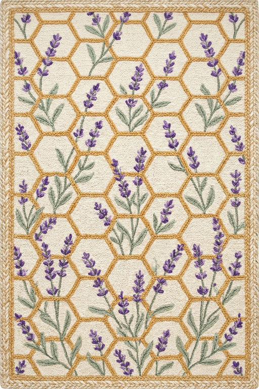 | 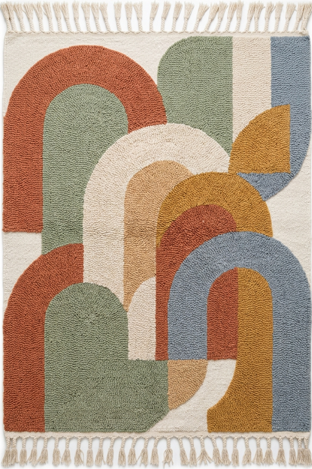 |

---

## 🛠️ Техническая архитектура

* **Движок**: Unity 6 / Unity 2022.3 LTS (C#)
* **Целевой пайплайн**: Mobile WebGL (адаптивный Canvas Scaler 9:16 Portrait)
* **Оптимизация**:
  * Стабильные 60 кадров/сек на мобильных браузерах (iOS Safari, Android Chrome).
  * Мгновенный расчёт процента чистоты без лагов за счёт фонового даунсэмплинга маски до 32×32.
  * Нулевое выделение памяти (0 GC allocs) во время непрерывной чистки.

---

## 📄 Авторские права и статус проекта

Этот репозиторий представляет собой **витрину портфолио (Showcase)**.  
Исходный код механик, шейдеры и игровые ресурсы являются коммерческой разработкой.

**Copyright (c) 2026. Все права защищены.**  
Копирование, распространение или коммерческое использование материалов проекта без письменного согласия правообладателя запрещено.
